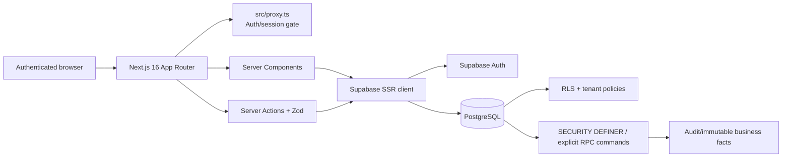

# Terranex Architecture

> Archaeology snapshot: 2026-08-17  
> Verified repository baseline: `main` at `9488588f0c6fd1984a1c09769af480f85905c661`  
> This is descriptive documentation of the current implementation, not a redesign proposal.

## 1. System shape

Terranex is a **single Next.js application** backed by Supabase Auth and PostgreSQL. It is not a monorepo and there is no separate application backend service in this repository.



### Verified technology baseline

- Next.js `16.0.1`.
- React / React DOM `19.2.0`.
- TypeScript 5.x.
- Zod `4.1.x`.
- Supabase JS `2.56.x` and Supabase SSR `0.7.x`.
- ESLint 9 / `eslint-config-next`.
- Vitest 4 + Testing Library/jsdom.
- npm with a committed `package-lock.json`.
- CI runtime: Node 20.
- CI database: PostgreSQL 15.
- Repository does not declare a Node `engines` version; Node 20 is therefore a CI fact, not a universal runtime guarantee.

## 2. Repository structure

```text
.github/
  workflows/
    greenfield-ci.yml
    pilot-activation.yml
  pilot-activation/
    activate.sh
scripts/
src/
  app/                 # App Router routes/layouts/styles
  features/            # domain modules, queries, Server Actions, schemas
  shared/              # money/idempotency/Supabase helpers
supabase/
  migrations/          # ordered PostgreSQL schema/business-rule evolution
  tests/               # SQL verification
  test-scripts/        # concurrency/restore/smoke/isolation verification
tests/                 # Vitest unit/component/integration-style tests
```

There is no package workspace configuration and no second package root: **verified non-monorepo**.

## 3. Frontend architecture

### App Router and server-first data flow

The primary path is:

```text
Route / Server Component
  -> authenticated organization/project context
  -> feature query
  -> Supabase server client
  -> RLS-scoped PostgreSQL data
```

Mutating forms primarily follow:

```text
Form
  -> Server Action
  -> Zod validation
  -> authenticated user/context check
  -> database RPC / controlled mutation
  -> database authorization + invariants + audit
  -> revalidatePath / redirect or result
```

This keeps browser input outside the trusted financial boundary.

### State management

- No Redux/Zustand/TanStack Query/global client-state package is present.
- Most data is server-fetched.
- Client state is component-local for interactive UI where needed.

### Forms and validation

- Feature modules commonly expose `schema.ts` plus Server Actions.
- Zod validates user/action payloads before database calls.
- Material business invariants are also implemented in PostgreSQL; client/server validation is not treated as the only integrity layer.

### Styling/responsive behavior

- Global CSS is in `src/app/globals.css`.
- Arabic font and RTL root behavior are configured in `src/app/layout.tsx`.
- Responsive adaptations are present around `960px` and `720px`.
- Wide tables use controlled horizontal overflow on small screens.

### Accessibility patterns

- Keyboard-visible focus states exist.
- Reduced-motion preferences are respected in CSS.
- Testing Library is used in parts of the component test suite.
- No axe/Pa11y/Lighthouse accessibility gate is part of current CI.
- Therefore WCAG 2.2 AA is a target in repository instructions, not a fully verified compliance result.

### Localization

- Current root runtime is Arabic/RTL: `lang="ar"`, `dir="rtl"`.
- No i18n framework/provider or locale routing was found.
- English/LTR support mentioned in instructions is not verified by current runtime code.

## 4. Backend/application-service architecture

There is **no separate Express/Nest/Fastify service** and no independent API application.

### Verified server-side mechanisms

- Next.js Server Components.
- Next.js Server Actions.
- Supabase SSR clients.
- PostgreSQL functions/RPCs for material commands.
- Path revalidation/redirect after successful commands.

### API routes/webhooks

No `src/app/api` route tree or route-handler surface appeared in the current production build/tree. No webhook receiver implementation was found.

### Jobs/queues/scheduled tasks

No application queue, worker process, or scheduled/cron application task is configured in the repository. `vercel.json` contains no cron configuration.

The repository architecture guidance explicitly resists adding queues/outbox/event-sourcing/offline-sync/external integration infrastructure without a demonstrated workflow need.

## 5. Database architecture

PostgreSQL is the authoritative integrity boundary for tenant isolation and material financial/operational commands.

### Foundation verified directly

The foundation migration creates and hardens core entities including:

- `organizations`
- `memberships`
- `investment_projects`
- `audit_events`

Important foundation behavior includes:

- PostgreSQL UUID generation through `pgcrypto`.
- `OWNER` / `MEMBER` membership roles.
- `ACTIVE` / `INACTIVE` membership state.
- Unique organization-user membership.
- Organization/project foreign keys with explicit deletion behavior.
- Project and audit relationships protected with `ON DELETE RESTRICT` where preserving historical integrity matters.
- RLS enabled and forced on tenant-sensitive foundation tables.
- Membership-aware helper functions.
- Direct write privileges restricted for critical mutations.
- Explicit RPC creation paths that validate and audit commands.
- Supporting tenant/status indexes.

### Schema evolution verified from current migrations

The ordered migration set extends the foundation across:

- project terms and funding;
- hardening/governance boundaries;
- costs/cash and finance;
- real-estate operations and revenue;
- close/correction;
- allocation/distribution mechanisms plus later policy-safety fail-close controls;
- segregation of duties and approval/exception controls;
- opening/import and pilot controls;
- intake/readiness;
- agriculture lifecycle/inputs/harvest/land/sale/profitability;
- livestock lifecycle/movement/biological/operational/commercial controls;
- portfolio hierarchy and roll-up;
- procurement/receiving;
- vendor finance/contracts/evidence-related hardening;
- credits, payment allocation, advances, settlement;
- budget control;
- currency/tax contract foundations;
- period-close health;
- integrity center;
- project performance;
- cross-sector assets/performance;
- governance;
- pre-owner policy safety;
- cash-account idempotency.

The complete migration chain was replayed successfully by the baseline CI database job.

### Tenant boundary

**Verified design:** `organization` membership is the principal tenant boundary. Tenant-sensitive rows are expected to carry organization attribution and be protected by database authorization/RLS. Project context is subordinate to that organization boundary.

### Financial integrity patterns

Repository instructions and current migrations/tests establish these implementation patterns:

- Exact database money semantics; no JavaScript floating-point value is trusted as the accounting authority.
- Material commands are atomic and database-authorized.
- Idempotency keys protect replay/retry behavior.
- Concurrency checks are tested at the database boundary.
- Posted/audited facts are preserved rather than silently rewritten.
- Economic investor allocation/distribution mutators are fail-closed until policy approval.

### Deletion behavior

Deletion is **not governed by one global application policy yet**. Current schema has entity-specific foreign-key behavior, including `RESTRICT` for important historical records. The broader account/data deletion and legal-retention policy remains open in `BD-012`; this document does not invent it.

### Seed data

No conventional application production seed contract was established as a source of truth in this pass. Test fixtures/setup exist for verification, and UI code contains synthetic/demo-mode behavior. Do not assume test/demo fixtures define production master data.

## 6. Authentication, authorization, and trust boundaries

### Authentication

`src/proxy.ts` refreshes/reads Supabase Auth session state and gates application navigation. Unauthenticated users are redirected to `/login`; authenticated users are redirected away from `/login`.

### Authorization

Authorization is layered:

1. Supabase Auth establishes user identity.
2. Application server code resolves membership/context.
3. PostgreSQL RLS/function authorization enforces tenant and command rules.
4. Material business RPCs implement invariants, idempotency, concurrency and audit behavior.

The browser is not a trusted authorization boundary.

### Account administration

Verified flows are login, logout, and authenticated first-organization onboarding. Self-registration, reset, invitation, and administrator user-provisioning flows were not found. Product policy for these remains open.

## 7. Integrations and external services

### Explicit application integration

**Supabase:**

- Auth.
- PostgreSQL access/RPC through Supabase client libraries.
- Repository architecture also references private Storage as the intended evidence/storage boundary, but live bucket state and production policies could not be inspected through the currently connected account.

### Deployment integration

**Vercel:**

- `vercel.json` identifies the project as Next.js.
- A manual GitHub Actions pilot-activation workflow can inspect/activate a pilot target when credentials are supplied.

### Not found in current application dependencies/configuration

No explicit SDK/configuration was found for:

- email delivery;
- payment processors;
- analytics;
- AI providers;
- maps.

This does not prove that no external infrastructure exists outside the repository. It means the current application implementation does not expose a verified integration for those services.

## 8. PWA and offline architecture

No PWA architecture is implemented on this baseline:

- no manifest;
- no service worker;
- no install/update flow;
- no offline application cache policy;
- no PWA package/configuration.

This is consistent with current repository architectural guidance.

## 9. Environment and configuration

### Application variables represented in the repository

Variable names only:

- `NEXT_PUBLIC_SUPABASE_URL`
- `NEXT_PUBLIC_SUPABASE_PUBLISHABLE_KEY` or legacy-compatible `NEXT_PUBLIC_SUPABASE_ANON_KEY`

`.env.example` documents the public application values. The committed production env file contains public `NEXT_PUBLIC_*` configuration; this architecture document intentionally does not reproduce any value.

Database verification scripts use database connection environment variables/URLs in CI or operator environments. Values are secrets and are not documentation content.

### Configuration separation

- Local ignored env files are supported by `.gitignore`.
- Public example/production configuration files are explicitly allowed by `.gitignore`.
- CI supplies build-time placeholder public Supabase values for compilation.
- Live Terranex production configuration was not accessible through the connected Supabase/Vercel accounts in this pass.

## 10. CI/CD and operational architecture

### `Greenfield CI`

On push to `main`/`codex/**`, pull request, or manual dispatch:

**Application job**

```text
npm ci
npm run lint
npm run test
npm run build
npm run typecheck
```

**Database job**

- PostgreSQL 15 service.
- `npm run test:db`.
- Full migration replay plus SQL, concurrency, replay/upgrade, backup/restore, smoke, and isolation verification.

### Pilot activation

`pilot-activation.yml` is manual and safety-oriented:

- inspection is the default posture;
- migration application defaults off;
- migration application requires explicit selection;
- credentials are taken from secrets rather than committed privileged values;
- backup/checksum behavior exists before explicit database migration activation;
- smoke verification is available.

This archaeology pass did **not** activate a pilot or production environment.

## 11. Monitoring, logging, backups, and rollback

### Verified in repository

- Application/database commands create audit/business records where implemented.
- CI contains database backup/restore and failure-safety verification suites.
- Pilot activation has pre-migration safety/backup steps.

### Unknown in live production

Because the connected Supabase and Vercel accounts do not expose a Terranex project, the following could not be verified:

- centralized runtime error monitoring;
- production log retention/search;
- alerting;
- scheduled production database backups and retention;
- restore point objectives;
- Vercel production deployment history;
- production rollback readiness;
- live storage bucket configuration;
- live RLS/security-advisor state.

No repository dependency/configuration for a dedicated observability service such as Sentry/Datadog/OpenTelemetry was found. That is a repository fact, not proof about external platform-level monitoring.

## 12. Security boundary summary

Trusted boundaries, strongest to weakest:

1. PostgreSQL constraints/RLS/RPC authorization and transaction semantics.
2. Supabase Auth verified server identity/session.
3. Next.js server-side context, actions, and validation.
4. Browser/UI input, treated as untrusted.

Current high-value security/governance unknowns are operational rather than a proven code failure: the live production project could not be inspected, and GitHub `main` is currently not branch-protected.
