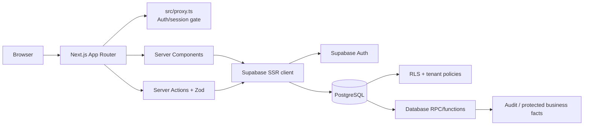

# Terranex Architecture

> Archaeology snapshot: 2026-08-17  
> Verified repository baseline: `main` at `9488588f0c6fd1984a1c09769af480f85905c661`  
> Descriptive only: this document maps the current implementation and does not redesign it.

## 1. System shape

Terranex is a **single Next.js application** backed by Supabase Auth and PostgreSQL. It is not a monorepo and this repository contains no separate application-backend service.



## 2. Verified technology baseline

Current `package.json` declares:

- Node engine: `>=20.9.0`.
- Next.js: `^16.0.0` (baseline CI resolved Next.js `16.3.0`).
- React / React DOM: `^19.2.0`.
- TypeScript: `^5`.
- Zod: `^4.1.0`.
- `@supabase/supabase-js`: `^2.57.0`.
- `@supabase/ssr`: `^0.8.0`.
- ESLint 9 / `eslint-config-next` `^16.0.0`.
- Vitest: `^3.2.4` (baseline CI ran Vitest `3.2.7`).
- Testing Library + jsdom.
- npm with committed `package-lock.json`.

Current CI uses Node 20 and PostgreSQL 16.

## 3. Repository structure

```text
.github/
  workflows/
    greenfield-ci.yml
    pilot-activation.yml
  pilot-activation/
    activate.sh
scripts/
src/
  app/                 # App Router routes/layouts/global styles
  features/            # domain modules, queries, Server Actions, schemas
  shared/              # shared money/idempotency/Supabase helpers
supabase/
  migrations/          # ordered PostgreSQL schema/business-rule evolution
  tests/               # SQL verification
  test-scripts/        # concurrency/replay/restore/smoke/isolation checks
tests/                 # Vitest tests
```

No package-workspace configuration or second package root was found: **verified non-monorepo**.

## 4. Frontend architecture

### Server-first data flow

```text
Route / Server Component
  -> authenticated organization/project context
  -> feature query
  -> Supabase server client
  -> RLS-scoped PostgreSQL data
```

Mutations primarily follow:

```text
Form
  -> Server Action
  -> Zod validation
  -> authenticated context check
  -> database RPC / controlled mutation
  -> DB authorization + invariants + audit
  -> revalidatePath / redirect / result
```

The browser is not treated as the trusted financial/security boundary.

### State management

- No Redux, Zustand, or TanStack Query dependency is present.
- Most authoritative state is server/database-derived.
- Client state is local where interaction requires it.

### Forms/validation

- Feature modules commonly pair schemas with Server Actions.
- Zod validates request/form payloads.
- Material invariants also live in PostgreSQL; UI/server validation is not the only integrity layer.

### Styling/responsiveness

- Global styles: `src/app/globals.css`.
- Root Arabic font/direction: `src/app/layout.tsx`.
- Responsive adaptations around `960px` and `720px`.
- Wide tables use horizontal overflow protection on smaller screens.

### Accessibility

**Verified patterns:** keyboard-visible focus styling, reduced-motion handling, and Testing Library coverage for parts of the UI.

**Not verified:** full WCAG 2.2 AA compliance. No axe/Pa11y/Lighthouse accessibility gate is in current CI.

### Localization

- Current root is fixed `lang="ar"`, `dir="rtl"`.
- No i18n framework/provider/locale routing was found.
- `AGENTS.md` says English/LTR is supported; the current runtime implementation does not independently verify that statement.
- `BD-008` keeps English/LTR rollout scope OPEN.

## 5. Backend/application-service architecture

There is no separate Express/Nest/Fastify service and no independent API application.

**Verified server mechanisms:**

- Next.js Server Components.
- Next.js Server Actions.
- Supabase SSR clients.
- PostgreSQL functions/RPCs for material commands.
- Path revalidation/redirect after successful operations.

### API routes/webhooks

No `src/app/api` route tree or route-handler surface appeared in the current tree/build. No webhook receiver implementation was found.

### Jobs/queues/schedules

No application queue, worker process, or scheduled/cron application task is configured. `vercel.json` contains no cron definition. This matches current repository guidance against adding such infrastructure without a proven workflow need.

## 6. Database architecture

PostgreSQL is the authoritative integrity boundary for tenant isolation and material financial/operational commands.

### Foundation verified directly

The foundation migration creates/hardens core entities including:

- `organizations`
- `memberships`
- `investment_projects`
- `audit_events`

Verified foundation behavior includes:

- UUID generation through `pgcrypto`.
- `OWNER` / `MEMBER` roles.
- `ACTIVE` / `INACTIVE` membership state.
- Unique organization-user membership.
- Explicit foreign-key deletion behavior.
- `ON DELETE RESTRICT` on important project/audit relationships.
- RLS plus forced RLS on tenant-sensitive foundation tables.
- Membership-aware helper functions.
- Restricted direct writes for critical paths.
- RPC creation paths with validation and audit.
- Tenant/status indexes.

### Schema evolution

Current ordered migrations extend the foundation across:

- project terms/funding;
- costs/cash/finance;
- real-estate operations/revenue;
- close/correction;
- historical allocation/distribution plus later policy-safety fail-close controls;
- segregation of duties, approvals, exceptions;
- opening/import and pilot controls;
- intake/readiness;
- agriculture lifecycle/inputs/harvest/land/sale/profitability;
- livestock lifecycle/movement/biological/operational/commercial controls;
- portfolio hierarchy/roll-up;
- procurement/receiving;
- vendor finance/contracts/credits/payment allocation/advances/settlement;
- budget control;
- currency/tax contract foundations;
- period-close health/integrity/performance;
- cross-sector assets/performance;
- governance;
- pre-owner policy safety;
- cash-account idempotency.

The complete migration chain replayed successfully in the verified PostgreSQL 16 CI database job.

### Tenant boundary

`organization` membership is the principal tenant boundary. Tenant-sensitive data is organization-attributed and protected through RLS/database authorization; project context is subordinate to the organization.

### Financial/data-integrity patterns

Current instructions, migrations, and database tests establish these patterns:

- No JavaScript floating-point value is trusted as the accounting authority.
- Database numeric/decimal semantics are authoritative for financial amounts.
- Material commands are atomic and database-authorized.
- Idempotency protects retry/replay behavior.
- Concurrency behavior is explicitly tested at the DB boundary.
- Posted/audited facts are preserved rather than silently rewritten.
- Investor allocation/distribution mutators are fail-closed until owner policy is approved.

### Deletion/retention

Deletion behavior is entity-specific through current foreign keys/policies; there is no single settled global retention policy. `BD-004` (“Evidence retention and deletion policy”) remains OPEN, so this document does not invent one.

### Seed data

Test fixtures/setup exist, but this discovery pass did not establish a conventional production seed contract as authoritative master data. Test/demo fixtures must not be treated as production truth.

## 7. Authentication/authorization/trust boundaries

### Authentication

`src/proxy.ts` reads/refreshes Supabase Auth state and gates navigation. Unauthenticated users are redirected to `/login`; authenticated users are redirected away from `/login`.

### Authorization

1. Supabase Auth establishes server-verified identity.
2. Application server code resolves membership/context.
3. PostgreSQL RLS/function authorization enforces tenant/command rules.
4. Material RPCs enforce invariants, idempotency, concurrency, and audit behavior.

### Account administration

Verified application flows are login, logout, and authenticated first-organization onboarding. Self-registration, password reset, invitation, and administrator provisioning were not found. Whether those are handled externally is unknown.

## 8. Integrations/external services

### Supabase

- Auth.
- PostgreSQL access/RPC through current Supabase libraries.
- Repository architecture identifies private Supabase Storage as an intended storage boundary; live bucket/policy state could not be inspected.

### Vercel

- `vercel.json` identifies Next.js deployment intent.
- Manual GitHub Actions pilot activation can inspect/activate an explicitly configured target.

### Not found as application integrations

No explicit SDK/configuration was found for email delivery, payment processors, analytics, AI providers, or maps. This does not rule out infrastructure outside the repository.

## 9. PWA/offline architecture

No PWA implementation is present:

- no manifest;
- no service worker;
- no install/update/offline-cache flow;
- no PWA package/configuration.

`BD-009` (“Browser installability”) is OPEN, and current repository guidance explicitly avoids premature PWA/offline complexity.

## 10. Environment/configuration

Application variable names represented in source/configuration:

```text
NEXT_PUBLIC_SUPABASE_URL
NEXT_PUBLIC_SUPABASE_PUBLISHABLE_KEY
NEXT_PUBLIC_SUPABASE_ANON_KEY
```

The app prefers `NEXT_PUBLIC_SUPABASE_PUBLISHABLE_KEY` with `NEXT_PUBLIC_SUPABASE_ANON_KEY` as compatibility fallback. Values are intentionally omitted.

- Local env files are ignored by `.gitignore` except explicitly allowed public example/production config.
- CI injects placeholder public Supabase values for compilation.
- Database scripts receive PostgreSQL connection values from the operator/CI environment.
- Live Terranex deployment configuration was not accessible through the currently connected Supabase/Vercel accounts.

## 11. CI/CD and operational architecture

### `Greenfield CI`

Triggers:

- push to `main`;
- pull request targeting `main`;
- manual `workflow_dispatch`.

Application job:

```bash
npm ci --no-audit --no-fund
npm run lint
npm test
npm run build
npx tsc --noEmit
```

Database job:

- PostgreSQL 16 service.
- `npm run db:test`.
- Full migration replay plus SQL/concurrency/replay/upgrade/backup-restore/smoke/isolation verification.

### Pilot activation

`pilot-activation.yml` is manual and safety-oriented:

- inspection-first default;
- migration application defaults off;
- explicit selection is required for migration application;
- privileged values come from GitHub Actions secrets;
- backup/checksum safeguards precede explicit migration activation;
- smoke verification is available.

This archaeology pass did not activate pilot or production.

## 12. Monitoring/logging/backups/rollback

### Verified in repository/test infrastructure

- Auditable business/database command patterns exist where implemented.
- DB CI includes backup/restore and failure-safety verification in a test environment.
- Pilot activation contains pre-migration backup/safety behavior.

### Live-state unknowns

Because no Terranex project was visible through the currently connected Supabase/Vercel accounts, this pass could not verify:

- centralized runtime error monitoring;
- production log retention/search;
- alerting;
- scheduled production backups/retention;
- RPO/RTO achievement (`BD-005` is OPEN);
- production restore/rollback readiness;
- deployment history;
- live Storage configuration;
- live RLS/security-advisor state.

No dedicated Sentry/Datadog/OpenTelemetry-style application dependency/configuration was found; platform-level observability outside this repository remains unknown.

## 13. Security boundary summary

Strongest trusted layers:

1. PostgreSQL constraints/RLS/RPC authorization/transactions.
2. Supabase Auth server identity/session.
3. Next.js server-side context/actions/validation.
4. Browser/UI input, treated as untrusted.

Two verified repository-governance facts require separate attention: GitHub currently reports the repository as public and `main` as not branch-protected. Neither condition by itself proves a code vulnerability, but owner intent and repository governance should be confirmed.
