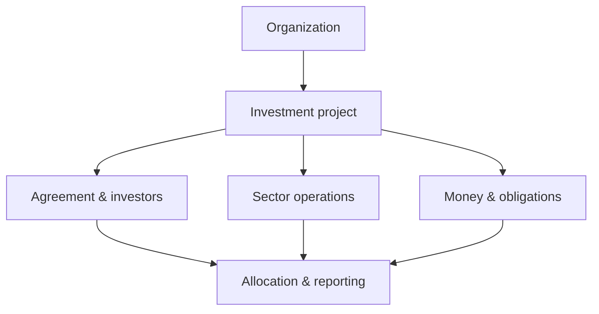

# Terranex Greenfield — 02 Operating Model & Journeys

**Status:** Foundational baseline v1  
**Depends on:** `01_PRODUCT_CHARTER_AND_MARKET.md`

## 1. Operating model

Terranex manages a portfolio of legally and economically distinct investment projects. Each project has a sector, lifecycle, parties, agreement versions, accounts, operations, documents, risks, and reporting boundary.

## 2. Roles and segregation of duties

| Role | Can prepare | Can approve | Cannot do alone |
|---|---|---|---|
| Organization owner | Configuration, invitations | Role grants, periods, material actions | Override immutable history |
| Investment manager | Project, budget, agreement draft, valuation, distribution proposal | Normal project changes within mandate | Approve own distribution/payment |
| Finance officer | Contributions, receipts, payments, obligations, reconciliation, journal draft | Low-risk entries if policy permits | Approve own high-value payment or reopen period |
| Sector manager | Plans, work events, quantities, evidence, completion | Operational event confirmation | Post bank movement or distribution |
| Reviewer/approver | Review queues and exceptions | Agreement, payment, valuation, distribution, close | Change prepared calculation silently |
| Investor | Profile and requested documents | Acknowledge notices when enabled | See other investors or operational private data |
| Auditor/read-only | Reports, evidence, audit trail | None | Modify any record |

Rules are organization-configurable only within safe templates. Default: maker and approver must be different users for bank payments, agreement activation, allocation, distribution, period close/reopen, and opening-balance import.

## 3. Project lifecycle

| State | Entry condition | Allowed work | Exit gate |
|---|---|---|---|
| DRAFT | Project shell created | Configure sector, parties, agreement, budget, asset | Required setup complete |
| DUE_DILIGENCE | Opportunity accepted for review | Documents, checks, assumptions, valuation, decision memo | Approved investment decision |
| FUNDING | Active agreement and commitment plan | Capital calls, contribution receipts, acquisition obligations | Minimum funding/acquisition condition met |
| ACTIVE | Project controls active | Full sector operations and finance | Approved exit/closure plan |
| EXITING | Disposal/harvest liquidation/closure started | Settlement, receivable collection, asset disposition | No unresolved material obligations |
| CLOSED | Periods closed and final statement approved | Read/report, permitted late adjustment by reopen workflow | Reopen approval only |
| CANCELLED | Pre-activation cancellation | Read-only plus documented reason | No transition back; clone if needed |

Lifecycle state does not replace asset or sector state. A project may be ACTIVE while one crop cycle is closed and another is planned.

## 4. Canonical end-to-end journeys

### J1 — Create and activate an investment project

1. Create project and choose exactly one primary sector.
2. Define legal/operating entity, location, reporting currency, dates, manager, and materiality policy.
3. Attach due-diligence checklist and evidence.
4. Define agreement version: participants, commitments, contribution basis, ownership/allocation rules, fees, decision rights, and distribution policy.
5. Configure project accounts and opening budget.
6. Add sector baseline: real-estate asset, farm/fields, or herd/cohorts.
7. System validates totals, dates, required evidence, role conflicts, and accounting setup.
8. Reviewer approves; activation creates an immutable agreement snapshot and audit event.

**Invariant:** operations that affect entitlement cannot predate the effective agreement unless entered through an approved opening/import workflow.

### J2 — Call and receive capital

1. Manager prepares a capital call with purpose, due date, amount, currency, and allocation basis.
2. System calculates each participant share from the effective agreement and shows rounding residual handling.
3. Reviewer approves; notices become immutable versions.
4. Finance records bank receipt against a participant and call line.
5. Receipt posts cash and capital contribution/receivable effects atomically.
6. Exceptions remain visible: short payment, overpayment, unidentified receipt, FX difference, or late receipt.
7. Investor capital statement updates only from posted events.

### J3 — Procure, incur, approve, and pay a cost

1. Sector/finance user records commitment or supplier obligation with project, work/cost category, expected date, tax fields, and evidence.
2. Receipt of goods/service records quantity and links to the sector object.
3. Invoice/claim is matched to obligation and receipt when applicable.
4. Approval policy routes by amount/category/project.
5. Payment proposal validates available cash, bank account, duplicate risk, and period.
6. Approval then posting updates obligation, cash, project cost, inventory/asset/WIP as defined by posting rule.
7. Bank reconciliation later confirms settlement without recreating the payment.

### J4 — Capture a sector event

1. Operator chooses project then sector object: parcel/phase, field/cycle, herd/cohort/animal.
2. Select event template; enter time, quantity, unit, responsible person, location, notes, and evidence.
3. Offline-capable draft may be saved with device time; server receipt time is retained separately.
4. Validation checks impossible dates, negative quantities, identity/state conflicts, and required inputs.
5. Confirmed event updates operational projections and may create inventory consumption, production, or a financial draft.
6. A material or exceptional event enters review; routine events post under policy.

### J5 — Record revenue and collection

1. Create sale/contract from sector output or asset disposition.
2. Capture customer, quantity/asset, price, tax, performance/delivery date, payment terms, and evidence.
3. Approval posts receivable/revenue and removes inventory or asset cost according to policy.
4. Collection is matched to the receivable; partial, withheld, disputed, and FX amounts stay explicit.
5. Cash receipt and revenue recognition remain separate events when their dates differ.

### J6 — Close a period and report performance

1. Resolve or explain unreconciled cash, unmatched documents, negative inventory, missing rates, and overdue approvals.
2. Record accruals, allocations, inventory counts, production, impairment/valuation proposals, and reversals.
3. Run subledger controls: balanced batches, project dimensions, partner capital rollforward, asset/inventory rollforward.
4. Reviewer approves close; system stores control results and locks the period.
5. Generate project pack: cash, P&L bridge, commitments, operational KPIs, valuation status, investor capital rollforward, and exceptions.

### J7 — Allocate result and distribute cash

1. Finance selects a closed reporting period and effective agreement version.
2. System calculates allocable realized result and each participant allocation; management valuation is excluded unless policy explicitly permits and is legally reviewed.
3. Manager proposes distributable cash after reserves, obligations, and minimum cash policy.
4. Reviewer approves the calculation snapshot and distribution notice.
5. Finance prepares payment; another approver authorizes posting.
6. Paid/rejected/returned states are recorded; capital accounts and payables update from postings.
7. Investor receives a statement linking opening capital, contributions, allocated result, distributions, and closing balance.

### J8 — Correct an error

1. User opens the posted event and chooses “Correct”.
2. System creates a reversal draft linked to the original, with mandatory reason and period treatment.
3. If original period is closed, correction uses an approved late-posting/reopen policy.
4. After approval, reversal posts; replacement event is prepared separately.
5. Original, reversal, replacement, actor, approvals, and documents remain connected.

## 5. Exception queues

Home and project workspaces prioritize actionable exceptions, not passive charts:

- approvals waiting on me;
- unidentified/unreconciled cash;
- overdue capital calls and obligations;
- missing evidence or broken matches;
- negative/implausible stock or animal state;
- planned work overdue;
- budget/quantity/price variance over threshold;
- expired document or permit;
- period-close blockers;
- failed integration/outbox items.

Each exception has owner, severity, due date, source, and resolution outcome. Dismissing without reason is not allowed.

## 6. State-machine rules

- Draft records may be edited and deleted if they created no posted effects.
- Submitted records are versioned; edits create a new draft version.
- Approved is not posted: posting is an atomic domain action with accounting/audit effects.
- Posted records cannot be edited or deleted.
- Voided/cancelled/reversed are distinct states with different financial effects.
- A status transition requires permission, current-version check, and idempotency key.
- State history records actor, time, previous/new state, reason, and approval reference.

## 7. Notification policy

Notifications are consequences of durable events, never the source of truth. In-app is mandatory; email/WhatsApp are optional delivery channels. Every notice has a stable ID, version, recipient scope, delivery status, and link to the canonical record. Sensitive financial values are not placed in push notification bodies by default.

## 8. Operational reports

| Cadence | Report | Core audience |
|---|---|---|
| Daily | Cash/approval/exception digest | Owner, finance |
| Weekly | Project operations vs plan and budget | Manager, sector lead |
| Monthly | Project performance and capital rollforward | Owner, finance, investors |
| Cycle/exit | Crop, herd cohort, or real-estate deal closeout | Management, investor |
| Ad hoc | Audit trail and evidence package | Auditor, dispute review |

## 9. Acceptance criteria for the operating model

- Every material workflow identifies maker, approver, posting event, evidence, exception path, and reversal path.
- A user can never infer that payment equals expense, receipt equals revenue, valuation equals realized profit, or allocation equals distribution.
- Partner statements can be regenerated from posted events and effective agreement versions.
- Sector events can exist without money; financial events can reference sector objects without embedding sector business logic in the finance core.

