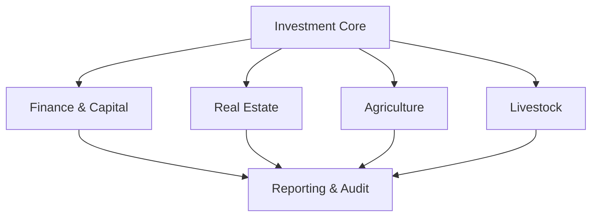
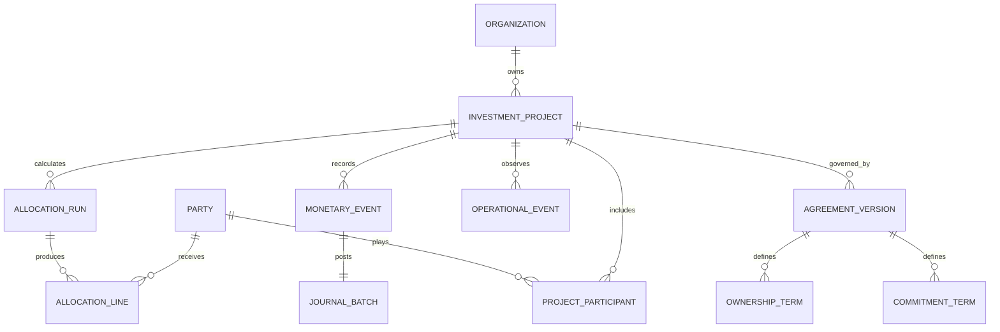

# Terranex Greenfield — 03 Domain Model

**Status:** Conceptual domain baseline v1 — not a database schema  
**Rule:** Names from legacy Terranex have no authority unless represented here by a current business need.

## 1. Bounded contexts

| Context | Owns | Must not own |
|---|---|---|
| Identity & Organization | tenant, membership, role, policy | project economics |
| Party & Compliance | person/org identity, contacts, verification/document status | ledger balances |
| Investment Core | project, lifecycle, agreement, participants, commitment, decision rights | field/herd-specific state |
| Finance & Capital | money events, obligations, journal, partner capital, allocation, distribution, close | editing operational truth |
| Documents & Workflow | evidence, version, approval, task, notification | final business state by itself |
| Real Estate | parcels, property/development/disposal state | crops or animals |
| Agriculture | farms, fields, crop cycles, activities, harvest lots | livestock identity |
| Livestock | sites, herds, cohorts, animals, health/weight/reproduction/movement | crop cycles |
| Reporting & Audit | projections, snapshots, read models, audit retrieval | primary mutable truth |

## 2. Shared language

| Term | Definition |
|---|---|
| Organization | A customer tenant with isolated users, settings, and data |
| Investment Project | Economic and control boundary for one deal/venture with one primary sector |
| Party | A person or legal organization that can play roles without duplicating identity |
| Project Participant | Party’s role in a project: sponsor, investor, operator, lender, vendor, customer, adviser |
| Agreement Version | Effective-dated immutable terms controlling commitments, ownership, allocations, fees, and decisions |
| Commitment | Maximum or scheduled value a participant agrees to contribute; not cash received |
| Capital Call | Approved request for a contribution under an agreement |
| Contribution | Posted cash or approved non-cash value contributed to a project |
| Ownership Interest | Effective-dated economic/control interest; not assumed equal to contributed cash |
| Allocation | Assignment of income/loss/cost/capital movement to a participant; not payment |
| Distribution | Approved transfer of value from project to participant |
| Operational Event | Timestamped sector fact such as work, harvest, movement, treatment, or milestone |
| Monetary Event | Business fact that generates a balanced posting, such as receipt, obligation, payment, sale |
| Evidence | Versioned file/metadata linked to the fact or decision it supports |
| Valuation | Dated estimate with method, source, reviewer, and confidence; not realized gain or cash |
| Close | Control process that locks a period after checks and approvals |

## 3. Aggregate map

### Organization aggregate

- `Organization`
- `Membership`
- `RoleAssignment`
- `ApprovalPolicy`
- `NumberSequence`
- `AccountingPolicySet`
- `CurrencyPolicy`

**Invariants:** every tenant-owned row has immutable `organization_id`; no membership may grant a permission outside role policy; sensitive policy changes are audited and effective-dated.

### Party aggregate

- `Party` (`PERSON | ORGANIZATION`)
- `PartyIdentifier`
- `ContactPoint`
- `Address`
- `BankInstruction` (masked and separately permissioned)
- `PartyDocument`
- `ComplianceCheck` (record-only in v1)

**Invariants:** identifiers are unique by type/issuer within organization where appropriate; bank instructions require verification state and change approval before payment use.

### Investment Project aggregate

- `InvestmentProject`
- `ProjectParticipant`
- `ProjectRoleMandate`
- `ProjectMilestone`
- `ProjectBudgetVersion`
- `RiskItem`
- `DecisionRecord`

**Invariants:** one primary sector; reporting currency fixed after first posting except migration workflow; closing requires resolved controls; lifecycle transitions are explicit commands.

### Investment Agreement aggregate

- `InvestmentAgreement`
- `AgreementVersion`
- `CommitmentTerm`
- `OwnershipTerm`
- `AllocationRule`
- `FeeRule`
- `DistributionPolicy`
- `DecisionRight`
- `SignatureRecord`

**Invariants:** activated versions are immutable; effective ranges cannot overlap for the same rule scope; allocation basis must resolve 100% using a deterministic rounding policy; signed document hash is retained.

### Capital aggregate

- `CapitalCall`
- `CapitalCallLine`
- `Contribution`
- `ContributionApplication`
- `PartnerCapitalAccount` (derived ledger view)
- `AllocationRun`
- `AllocationLine`
- `Distribution`
- `DistributionLine`
- `DistributionPayment`

**Invariants:** calls do not change cash/capital until contribution; allocation run references closed inputs and exact agreement version; distribution cannot exceed approved payable/distributable balance; paid value comes only from posted payment.

### Finance aggregate

- `FinancialAccount` (bank, cash, clearing, operational category)
- `BankStatement` / `BankStatementLine`
- `Receipt` / `Payment`
- `Obligation` / `ObligationSettlement`
- `Sale` / `PurchaseClaim`
- `JournalBatch` / `JournalLine`
- `AccountingPeriod`
- `PostingRuleVersion`
- `ReconciliationMatch`
- `ExchangeRate`

**Invariants:** journal debits equal credits per currency/batch rules; amounts use integer minor units; posted batch is immutable; source event posts at most once per idempotency key; bank statement line has at most one active reconciliation outcome.

### Workflow and evidence aggregates

- `ApprovalRequest` / `ApprovalStep` / `ApprovalDecision`
- `Task`
- `Document` / `DocumentVersion` / `DocumentLink`
- `Notification` / `DeliveryAttempt`
- `AuditEvent`

**Invariants:** approval records the exact subject version and calculation hash; replacing a document creates a version; audit records are append-only and cannot contain secrets.

## 4. Entity relationships

Sector tables connect through `investment_project_id` and their own roots; they do not share one universal “asset activity” table.

## 5. Value objects

| Value object | Fields/rules |
|---|---|
| Money | `minor_units:int64`, `currency:ISO-4217`; same-currency arithmetic only |
| Quantity | decimal value + UCUM/domain unit; conversions require explicit conversion factor/version |
| EffectiveRange | inclusive start, exclusive end; no overlap in same scope |
| Percentage | scaled integer/decimal with declared precision; sums validated |
| ExchangeRate | base, quote, rational/decimal rate, source, timestamp, usage type |
| DocumentRef | document/version ID, content hash, classification |
| GeoPoint/Area | coordinate reference + measurement unit; no string-only area |
| EventTime | occurred_at, recorded_at, timezone, optional device time |
| ReferenceNumber | organization sequence + type + period; never primary key |

## 6. Domain events

Events use past tense and are immutable facts. Examples:

- `ProjectActivated`
- `AgreementVersionActivated`
- `CapitalCallApproved`
- `ContributionPosted`
- `ObligationRecognized`
- `PaymentPosted`
- `OperationalEventConfirmed`
- `HarvestLotCreated`
- `AnimalMoved`
- `SaleRecognized`
- `PeriodClosed`
- `ResultAllocated`
- `DistributionApproved`
- `DistributionPaid`
- `PostedEventReversed`

Every event carries event ID, organization, aggregate ID/version, actor, occurred/recorded time, command idempotency key, correlation/causation IDs, and minimal non-secret payload. Integration events are emitted through an outbox after commit.

## 7. Commands vs facts vs projections

| Type | Example | Mutability |
|---|---|---|
| Command | Approve distribution | Request; may fail validation |
| Fact | DistributionApproved | Immutable after commit |
| Projection | Investor balance card | Rebuildable from facts/postings |

The UI never writes projections directly. Balances, dashboards, profitability, inventory position, and partner statements are derived/read models with an “as of” time and source completeness state.

## 8. Cross-context contracts

- Sector contexts publish confirmed quantity/state events; Finance decides monetary recognition through versioned posting rules.
- Finance publishes posted cost/revenue/cash facts; sector reports consume project and sector-object dimensions.
- Agreement context supplies the effective rules to Capital; Capital stores the exact version and calculation inputs used.
- Documents link through typed references; no context owns arbitrary document blobs.
- Reporting reads stable projections and never bypasses tenant/role policies.

## 9. Prohibited shortcuts

- `partner.balance` or `project.profit` stored as manually editable columns;
- one mutable ownership percentage on project;
- using current agreement terms to recalculate historical allocations;
- polymorphic strings without referential integrity for financial dimensions;
- one “transaction” table mixing draft, cash, revenue, cost, journal, and bank statement concepts;
- negative inventory as a normal correction mechanism;
- deleting a participant with historical postings;
- status updates that bypass command validation and audit.

## 10. Open discovery items

These require real design-partner documents before physical schema design:

1. common legal structures and whether project/SPV/contract boundaries differ;
2. ownership vs profit-sharing variations and non-cash contribution valuation;
3. management fees, operator shares, reserves, withholding, and loss carryforward;
4. whether agricultural/livestock customers manage at lot/cohort or individual level;
5. sector-specific units, local permits, and document retention requirements;
6. required external accounting and Egyptian e-invoice mappings.

Unknowns must become configurable policy or an explicit later phase—not nullable ambiguity in the core model.

