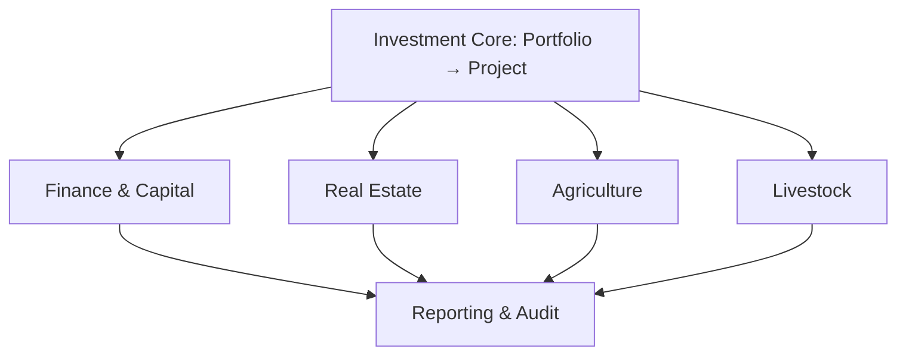
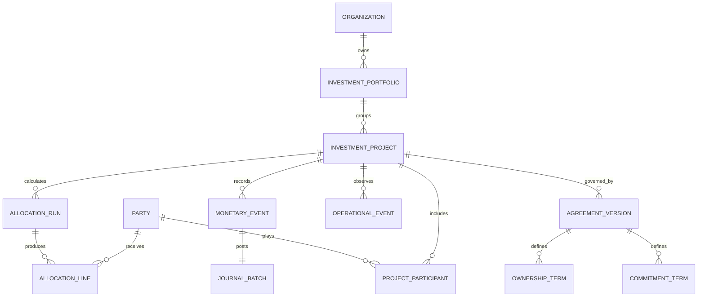

# Terranex Greenfield — 03 Domain Model

**Status:** Conceptual domain baseline v1 — not a database schema
**Rule:** Names from legacy Terranex have no authority unless represented here by a current business need.

## 1. Bounded contexts

| Context | Owns | Must not own |
|---|---|---|
| Identity & Organization | tenant, membership, role, policy | project economics |
| Party & Compliance | person/org identity, contacts, verification/document status | ledger balances |
| Investment Core | portfolio, project, lifecycle, approved agreement/participant relationships, decision rights | field/herd-specific state or invented investor economics |
| Finance & Capital | money events, obligations, journal, partner capital, allocation, distribution, close | editing operational truth |
| Documents & Workflow | evidence, version, approval, task, notification | final business state by itself |
| Real Estate | parcels, property/development/disposal state | crops or animals |
| Agriculture | farms, fields, crop cycles, activities, harvest lots | livestock identity |
| Livestock | sites, herds, cohorts, animals, health/weight/reproduction/movement | crop cycles |
| Reporting & Audit | projections, snapshots, read models, audit retrieval | primary mutable truth |

## 2. Shared language

| Term | Definition |
|---|---|
| Organization | A customer tenant with isolated users, settings, and data |
| Investment Portfolio | Organization-scoped management/reporting container above projects; not automatically a legal entity, fund, pooled vehicle, or investor pool |
| Investment Project | Operational, budget, financial-attribution, execution, and close boundary for one deal/venture with one primary sector |
| Party | A person or legal organization that can play roles without duplicating identity |
| Project Participant | Party’s approved role in a project: sponsor, investor, operator, lender, vendor, customer, adviser |
| Portfolio Capital Deployment | Approved management/funding decision assigning capital capacity/value to a project; not an investor contribution or entitlement |
| Agreement Version | Effective-dated immutable terms for the scope actually approved; ownership/allocation/fee/distribution rules exist only when supported by real business terms |
| Commitment | Maximum or scheduled value a participant agrees to contribute under approved terms; not cash received |
| Capital Call | Approved request for a contribution under an explicitly approved agreement scope; not a universal funding rule |
| Contribution | Posted cash or approved non-cash value accepted from an identified participant under an approved agreement scope; its legal/economic Portfolio, Project, entity, or other boundary is not inferred |
| Ownership Interest | Effective-dated economic/control interest under approved terms; not assumed equal to contributed cash |
| Allocation | Assignment of income/loss/cost/capital movement to a participant under an approved rule; not payment |
| Distribution | Approved payable/transfer of value to a participant under an approved governing scope; its Project, Portfolio, or legal-entity boundary is not inferred |
| Operational Event | Timestamped sector fact such as work, harvest, movement, treatment, or milestone |
| Monetary Event | Business fact that generates a balanced posting, such as receipt, obligation, payment, sale |
| Evidence | Versioned file/metadata linked to the fact or decision it supports |
| Valuation | Dated estimate with method, source, reviewer, and confidence; not realized gain or cash |
| Close | Control process that locks a period after checks and approvals |

## 3. Aggregate map

This is a conceptual ownership map, not an implementation backlog. Create an aggregate/table only when an approved vertical slice uses it. Existing implementation history does not authorize new portfolio/investor schema from this document alone.

### Investment Portfolio aggregate

- `InvestmentPortfolio`
- project membership/association is a conceptual relationship; its physical representation is deferred until implementation is explicitly authorized.

**Invariants:** a portfolio belongs to one Organization; a portfolio is not automatically a legal/fund/SPV boundary; membership does not merge project assets, cash, liabilities, agreements, or investor economics; portfolio totals are derived from project truth.

### Organization aggregate

- `Organization`
- `Membership`
- `RoleAssignment`
- `ApprovalPolicy`
- `NumberSequence`
- `AccountingPolicySet`
- `CurrencyPolicy`

**Invariants:** every tenant-owned row has immutable `organization_id`; no membership may grant a permission outside role policy; sensitive policy changes are audited and effective-dated.

### Party aggregate

- `Party` (`PERSON | ORGANIZATION`)
- `PartyIdentifier`
- `ContactPoint`
- `Address`
- `BankInstruction` (masked and separately permissioned)
- `PartyDocument`
- `ComplianceCheck` (record-only in v1)

**Invariants:** identifiers are unique by type/issuer within organization where appropriate; bank instructions require verification state and change approval before payment use.

### Investment Project aggregate

- `InvestmentProject`
- `ProjectParticipant`
- `ProjectRoleMandate`
- `ProjectMilestone`
- `ProjectBudgetVersion`
- `RiskItem`
- `DecisionRecord`

**Invariants:** one primary sector; project belongs to the organization and management portfolio context chosen by approved product rules; reporting currency fixed after first posting except migration workflow; closing requires resolved controls; lifecycle transitions are explicit commands; project economics remain independently traceable.

### Investment Agreement aggregate

- `InvestmentAgreement`
- `AgreementVersion`
- `CommitmentTerm`
- `OwnershipTerm`
- `AllocationRule`
- `FeeRule`
- `DistributionPolicy`
- `DecisionRight`
- `SignatureRecord`

**Invariants:** activated versions are immutable; effective ranges cannot overlap for the same rule scope; only approved agreement rules may be represented; when an allocation basis exists it must resolve deterministically; signed document hash is retained. Portfolio membership alone never supplies agreement terms.

### Capital aggregate

- `CapitalCall`
- `CapitalCallLine`
- `Contribution`
- `ContributionApplication`
- `PartnerCapitalAccount` (derived ledger view)
- `AllocationRun`
- `AllocationLine`
- `Distribution`
- `DistributionLine`
- `DistributionPayment`

**Invariants:** capital calls/contributions/allocation/distribution are investor-capital mechanisms enabled only under approved governing terms, not synonyms for portfolio capital deployment; calls do not change cash/capital until contribution; allocation run references closed inputs and exact approved rule version; distribution cannot exceed an approved payable/distributable balance; paid value comes only from posted payment. If the investor model is unresolved, these aggregates must not be extended or generalized by assumption.

### Finance aggregate

- `FinancialAccount` (bank, cash, clearing, operational category)
- `BankStatement` / `BankStatementLine`
- `Receipt` / `Payment`
- `Obligation` / `ObligationSettlement`
- `Sale` / `PurchaseClaim`
- `JournalBatch` / `JournalLine`
- `AccountingPeriod`
- `PostingRuleVersion`
- `ReconciliationMatch`
- `ExchangeRate`

**Invariants:** journal debits equal credits per currency/batch rules; amounts use integer minor units; posted batch is immutable; source event posts at most once per idempotency key; bank statement line has at most one active reconciliation outcome.

### Workflow and evidence aggregates

- `ApprovalRequest` / `ApprovalStep` / `ApprovalDecision`
- `Task`
- `Document` / `DocumentVersion` / `DocumentLink`
- `Notification` / `DeliveryAttempt`
- `AuditEvent`

**Invariants:** approval records the exact subject version and calculation hash; replacing a document creates a version; audit records are append-only and cannot contain secrets.

## 4. Entity relationships

Sector tables connect through `investment_project_id` and their own roots; they do not share one universal “asset activity” table. Portfolio is a parent management/reporting context, not a replacement foreign-key target for sector facts.

## 5. Value objects

| Value object | Fields/rules |
|---|---|
| Money | `minor_units:int64`, `currency:ISO-4217`; same-currency arithmetic only |
| Quantity | decimal value + UCUM/domain unit; conversions require explicit conversion factor/version |
| EffectiveRange | inclusive start, exclusive end; no overlap in same scope |
| Percentage | scaled integer/decimal with declared precision; sums validated |
| ExchangeRate | base, quote, rational/decimal rate, source, timestamp, usage type |
| DocumentRef | document/version ID, content hash, classification |
| GeoPoint/Area | coordinate reference + measurement unit; no string-only area |
| EventTime | occurred_at, recorded_at, timezone, optional device time |
| ReferenceNumber | organization sequence + type + period; never primary key |

## 6. Domain events

Events use past tense and are immutable facts. Examples:

- `PortfolioCreated`
- `ProjectAssignedToPortfolio`
- `PortfolioCapitalDeploymentApproved`
- `ProjectActivated`
- `AgreementVersionActivated`
- `CapitalCallApproved`
- `ContributionPosted`
- `ObligationRecognized`
- `PaymentPosted`
- `OperationalEventConfirmed`
- `HarvestLotCreated`
- `AnimalMoved`
- `SaleRecognized`
- `PeriodClosed`
- `ResultAllocated`
- `DistributionApproved`
- `DistributionPaid`
- `PostedEventReversed`

Every event carries event ID, organization, aggregate ID/version, actor, occurred/recorded time, command idempotency key, correlation/causation IDs, and minimal non-secret payload. Integration events are introduced only when a real external consumer exists. At that point, durable delivery may use a transactional outbox after a recorded decision; internal domain behavior remains in-process.

## 7. Commands vs facts vs projections

| Type | Example | Mutability |
|---|---|---|
| Command | Approve distribution | Request; may fail validation |
| Fact | DistributionApproved | Immutable after commit |
| Projection | Investor balance card | Rebuildable from facts/postings |

The UI never writes projections directly. Balances, dashboards, profitability, inventory position, and partner statements are derived/read models with an “as of” time and source completeness state.

## 8. Cross-context contracts

- Sector contexts publish confirmed quantity/state events; Finance decides monetary recognition through versioned posting rules.
- Finance publishes posted cost/revenue/cash facts; sector reports consume project and sector-object dimensions.
- Portfolio context supplies management grouping/deployment context; it does not invent investor/legal/economic rules.
- Agreement context supplies only approved effective rules to Capital; Capital stores the exact version and calculation inputs used.
- Documents link through typed references; no context owns arbitrary document blobs.
- Reporting reads stable projections and never bypasses tenant/role policies.

## 9. Prohibited shortcuts

- `partner.balance` or `project.profit` stored as manually editable columns;
- treating Portfolio as a fund/SPV/legal entity or shared investor pool without an explicit approved business decision;
- converting portfolio capital deployment into investor contribution/ownership/allocation/distribution by inference;
- cross-project netting/recycling/transfers without an explicit approved mechanism and accounting treatment;
- one mutable ownership percentage on project;
- using current agreement terms to recalculate historical allocations;
- polymorphic strings without referential integrity for financial dimensions;
- one “transaction” table mixing draft, cash, revenue, cost, journal, and bank statement concepts;
- negative inventory as a normal correction mechanism;
- deleting a participant with historical postings;
- status updates that bypass command validation and audit.

## 10. Deferred / business-dependent investor model — hard stop

The shared operational core can model Portfolio → Project and project-authoritative operations/finance without deciding the company’s unresolved investor/legal/economic structure. **Do not implement or extend investor economics beyond already-approved behavior until the relevant owner decisions are recorded.**

Open questions include, at minimum:

1. Is the Portfolio only a management grouping, or does any real legal/entity/contract boundary exist above projects?
2. Who provides capital: the operating company, named investors/partners, project-specific investors, or a mixture?
3. Do investors participate at portfolio level, project level, or both? Can one investor have different terms by project?
4. What is the legally/economically authoritative meaning of “ownership”: company shares, project interest, contractual profit share, capital-account units, another basis, or combinations?
5. Are capital calls/contributions actually used in the first company, or is project funding recorded as company cash deployment/current account/loan/equity by another mechanism?
6. How are realized profits and losses assigned: by ownership, funding, fixed shares, project-specific agreements, operator fee/share, or another approved rule?
7. Are unrealized valuations ever allocable/distributable, or informational only?
8. What reserves, minimum cash, outstanding obligations, tax/withholding, management/operator fees, and loss carryforward rules affect distributable cash?
9. Can cash or capital be transferred/recycled between projects? If yes, under what approval, due-to/from, loan, or capital treatment?
10. Can profits/losses be netted across projects?
11. What happens when an investor enters/exits, transfers interest, partially withdraws, defaults on funding, dies, or changes legal identity?
12. Which statements/notices are contractual requirements and which are management reports only?

These questions are tracked in `docs/OPEN_BUSINESS_DECISIONS.md`. Until answered, the canonical rule is **explicit uncertainty, not invented configuration**. Existing working features remain implementation facts, but they must not be generalized into a new universal investor model without approval.

Other deferred sector/country assumptions remain bounded:

- whether agricultural/livestock customers manage at lot/cohort or individual level;
- sector-specific units, local permits, and document retention requirements;
- required external accounting and Egyptian e-invoice mappings.

Unknowns become an explicit later decision, typed configuration, or bounded extension only after evidence exists—not nullable ambiguity or guessed business logic in the core model.
