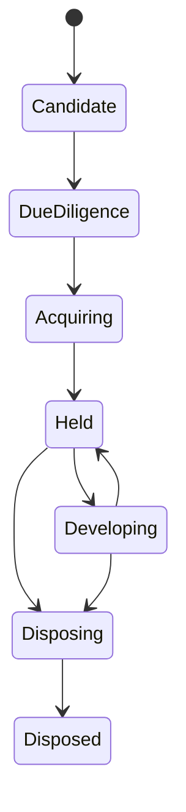
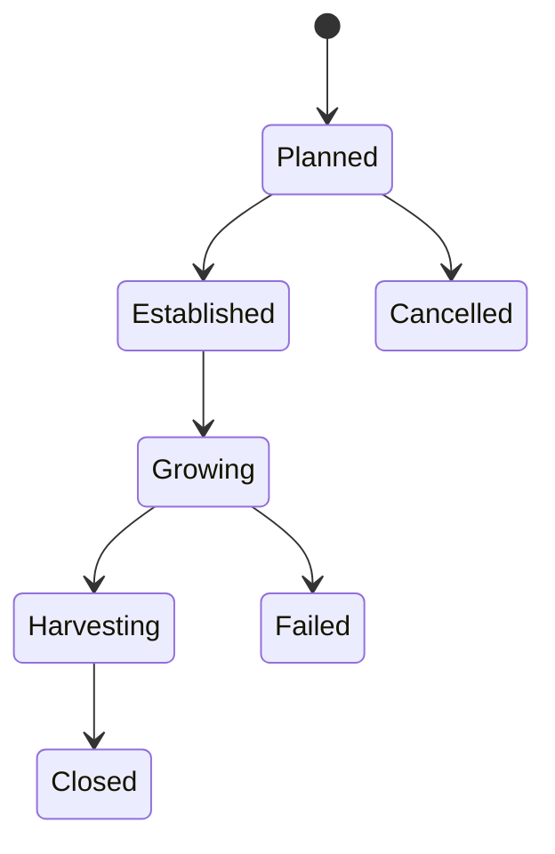
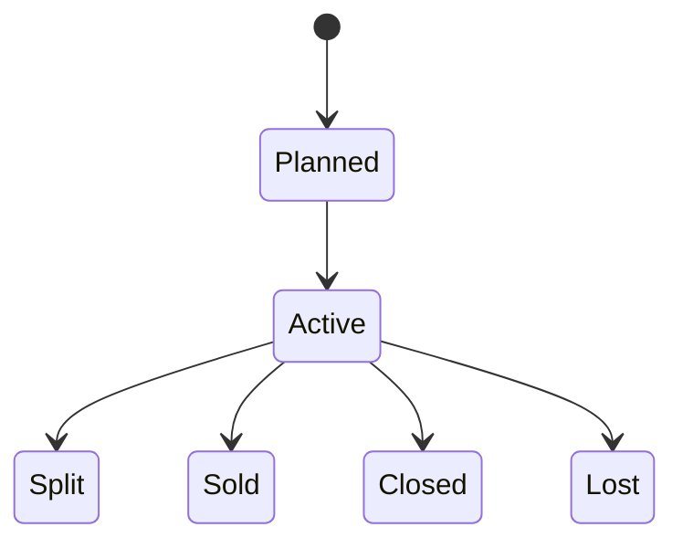

# Terranex Greenfield — 04 Sector Models

**Status:** Sector bounded-context baseline v1  
**Decision:** Share investment, finance, party, document, and workflow primitives. Keep sector operations independent.

## 1. Common sector contract

Every sector pack must provide:

- a sector root linked to one `InvestmentProject`;
- lifecycle/state model;
- operational objects and events;
- planned vs actual quantities/cost dimensions;
- evidence and responsible person;
- inventory/asset outputs;
- valuation inputs clearly separated from posted financial facts;
- closeout controls and sector KPIs.

It must not implement ownership, partner balances, payments, or journals independently.

## 2. Real-estate investment context

### Recommended v1 scope

Acquisition, light development/land preparation, holding costs, milestones, valuation records, and disposal. Leasing/property-management is a later bounded context.

### Model

- `RealEstateProjectProfile`: strategy (`ACQUIRE_HOLD | DEVELOP_SELL | LAND_TRADE`), jurisdiction, title status.
- `PropertyAsset`: economic asset acquired/controlled by project.
- `Parcel`: cadastral/title identifiers, area, geo boundary, legal description.
- `Structure` and `Unit`: optional hierarchy only where the deal needs it.
- `DevelopmentPhase`: planned dates, budget, milestones, completion measure.
- `Acquisition`: seller, contract, consideration, closing costs, possession/title dates.
- `PropertyCostItem`: category, capitalizable policy decision, phase/parcel dimension.
- `Valuation`: effective date, valuer/source, method, amount, assumptions, confidence, approval.
- `Disposition`: buyer, asset scope, contract, proceeds, selling costs, closing/collection state.
- `Title/Permit/Inspection`: typed compliance record with expiry/status/evidence.

### Lifecycle

### Critical events

- offer submitted/accepted;
- due-diligence check completed/failed;
- acquisition contract signed;
- consideration/closing cost obligated and paid;
- title/possession transferred;
- development milestone started/completed;
- valuation proposed/approved;
- disposal contract signed;
- control transferred and sale recognized;
- proceeds collected and asset derecognized.

### Controls and KPIs

- no “owned” state without acquisition/control evidence;
- title status, possession, and payment status are independent;
- cost-to-date vs approved budget by parcel/phase/category;
- committed cost, forecast-at-completion, variance, and contingency;
- purchase-to-sale days, gross margin, net realized margin, cash-on-cash return;
- valuation date/source/staleness and realized-vs-last-valuation bridge;
- disposal profit uses recognized proceeds minus carrying amount and selling costs, not cash received alone.

### Accounting policy hooks

Classification is policy-driven: inventory held for ordinary-course sale (IAS 2), owner-used PPE (IAS 16), or investment property (IAS 40). The UI must not infer classification from the word “property.” Transfers/classification changes require approved evidence and effective date.

## 3. Agriculture context

### Recommended v1 scope

Crop farming from seasonal plan through field work, input consumption, harvest lots, storage, sale, and cycle profitability. Processing/manufacturing is out.

### Model

- `Farm`: operating location, tenure/control, timezone, map.
- `Field`: stable land block with area, soil/irrigation attributes.
- `CropCycle`: crop/variety, fields, season, planned dates, target yield, state.
- `FieldActivity`: prepare, plant, irrigate, fertilize, spray, scout, weed, harvest, other.
- `InputItem` / `InputLot`: seed, fertilizer, chemical, fuel, packaging with unit and expiry/lot.
- `InputApplication`: activity, field area, quantity, rate, operator, weather/safety evidence.
- `HarvestEvent`: field/cycle, date, gross/net quantity, grade, loss, destination.
- `HarvestLot`: traceable output lot created at harvest.
- `StorageLocation` / `InventoryMovement`: receipt, transfer, adjustment, sale issue, spoilage.
- `AgronomyObservation`: pest/disease/growth/soil/weather note; no automated diagnosis in v1.

### Lifecycle

### Critical events

- cycle approved;
- input reserved/issued/applied;
- field work completed;
- crop observation recorded;
- harvest weighed and lot created;
- lot transferred/graded/spoiled/sold;
- cycle costs allocated and cycle closed.

### Traceability

Use one-step-back/one-step-forward capable lot records: field/cycle, inputs and input lots, activities, harvest lot, storage movements, and customer dispatch. FAO guidance emphasizes production records such as agricultural inputs, while GS1 traceability standards provide event/identifier patterns. Terranex stores compatible identifiers and event lineage but does not claim GS1 certification in v1.

### Controls and KPIs

- area assigned to concurrent cycles cannot exceed field policy;
- input application validates unit, rate, lot expiry, and available inventory;
- harvest output cannot be sold before it exists; adjustments require reason/approval;
- planned vs actual input rate, work, yield, and cost per feddan/hectare;
- yield per area, grade mix, loss/spoilage, realized selling price, gross margin per cycle;
- biological/management valuation is separate from realizable inventory and realized profit.

### Accounting policy hooks

IAS 41 addresses biological assets during transformation and agricultural produce at harvest; subsequent processing/inventory is outside its agricultural-produce scope and may fall under IAS 2. Terranex captures quantities, fair-value inputs, harvest point, and costs; the customer’s approved accounting policy determines posting.

## 4. Livestock context

### Recommended v1 scope

Meat/breeding herd management using **cohort-first** records, with optional individual animal records for high-value breeding, compliance, or tag-based operations. Dairy production and feed formulation are later modules.

### Model

- `LivestockSite`: farm/barn/pasture location.
- `Herd`: managerial grouping by species/purpose.
- `Cohort`: same acquisition/birth/production group with count and weight basis.
- `Animal`: optional unique identity, tag/RFID, sex, breed, birth/acquisition, dam/sire where relevant.
- `AnimalMembership`: effective movement between cohort/herd/site.
- `HealthEvent`: vaccination, treatment, diagnosis/observation, withdrawal period, provider, medicine lot.
- `WeightEvent`: individual or sampled/cohort weight with method and sample size.
- `ReproductionEvent`: breeding, pregnancy check, birth, weaning.
- `MortalityEvent`: count/animal, cause, evidence, disposal method.
- `FeedIssue`: feed lot, quantity, cohort, period.
- `LivestockSale`: animals/cohort quantity, live weight, price basis, buyer, transfer.

### Identity rule

Do not force every customer to create an `Animal` row. A cohort has a count and rollforward. Individual identity is enabled per herd/purpose. Moving between cohort and individual tracking requires a controlled split/identify workflow so totals reconcile.

### Lifecycle

Animal states include active, sold, transferred, dead, missing, and culled. State transitions arise from events, not direct edits.

### Critical events

- cohort acquired/born;
- animals identified or cohort split/merged;
- site/herd movement recorded;
- feed/medicine issued;
- health/weight/reproduction event confirmed;
- birth/death/loss recorded;
- sale transfer and collection recorded;
- cohort closed with count and value rollforward.

### Controls and KPIs

- opening + births + purchases + transfers in − sales − deaths − transfers out = closing headcount;
- individual tag is unique within applicable issuer/species scope;
- medicine withdrawal window blocks sale warning/approval;
- feed and medicine use must reference available lots or approved emergency exception;
- mortality, average daily gain, feed cost per head/kg gain, birth/weaning rate, sale weight and margin;
- sampled weights show sample size and confidence, not false precision for every animal.

AgriWebb’s mature patterns support mobile animal, movement, health, breeding, and RFID records. GS1/FAO traceability patterns support lifecycle lineage. Terranex adopts the record discipline, not vendor-specific workflows.

### Accounting policy hooks

Livestock classification and measurement depend on purpose and policy. Terranex records biological transformation, acquisition, birth, mortality, weight, and sale evidence; finance applies approved IAS 41/other policy rules without operators entering journals.

## 5. Cross-sector dimensions

| Dimension | Real estate | Agriculture | Livestock |
|---|---|---|---|
| Operational unit | parcel/phase/unit | field/cycle/harvest lot | herd/cohort/animal |
| Quantity | area/completion/unit count | area/input/output weight | headcount/weight/feed |
| Production output | disposed asset/unit | harvest lot | animal/cohort/product later |
| Main loss event | impairment/damage/delay | crop failure/spoilage | mortality/missing/disease |
| Closeout | disposition | crop cycle | cohort/production cycle |

Financial reports share project and cost categories but retain sector object identifiers for drill-down.

## 6. Sector-pack release gate

A sector pack cannot ship until it has:

- lifecycle and invariant tests;
- quantity/headcount/inventory rollforward;
- offline draft/conflict behavior for field capture;
- posting-rule mapping for core purchases, production, sale, and loss events;
- project/cycle closeout report;
- Arabic terminology reviewed by a real operator;
- real customer sample data and documents replayed end-to-end.

## Sources

- [IFRS IAS 40 — Investment Property](https://www.ifrs.org/issued-standards/list-of-standards/ias-40-investment-property/)
- [IFRS IAS 41 — Agriculture](https://www.ifrs.org/issued-standards/list-of-standards/ias-41-agriculture/)
- [IFRS IAS 2 — Inventories](https://www.ifrs.org/issued-standards/list-of-standards/ias-2-inventories/)
- [IFRS IAS 16 — Property, Plant and Equipment](https://www.ifrs.org/issued-standards/list-of-standards/ias-16-property-plant-and-equipment/)
- [FAO Food Traceability Guidance](https://openknowledge.fao.org/server/api/core/bitstreams/73065421-9aae-440a-8362-5ea847deb2eb/content)
- [GS1 Global Traceability Standard](https://www.gs1.org/standards/gs1-global-traceability-standard/current-standard)
- [AGRIVI Farm Enterprise](https://www.agrivi.com/products/360-farm-enterprise/)
- [AgriWebb Animal Management](https://www.agriwebb.com/us/solutions/animal-management/)

