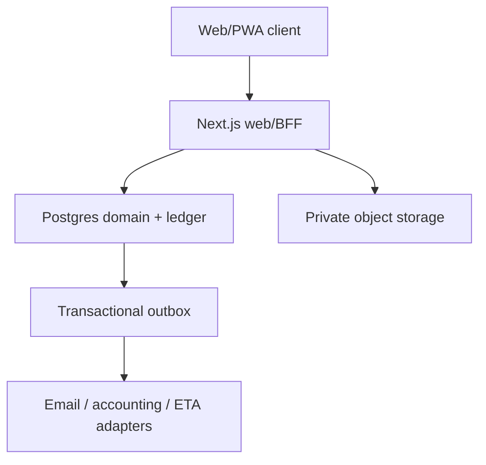

# Terranex Greenfield — 06 System Architecture & Security

**Status:** Execution-ready target architecture v1  
**Decision:** Modular monolith first; strong transaction boundaries; no microservices until measured scale/team needs justify extraction.

## 1. Architecture outcome

Build a multi-tenant Arabic-first PWA using TypeScript, a maintained Next.js App Router release, PostgreSQL through Supabase, Supabase Auth and private Storage, and Vercel deployment. Domain and financial commands execute server-side through transactional application services/database functions. The browser never becomes the authority for balances, approval, or posting.



## 2. Why this shape

- One deployable and one relational transaction boundary fit the first team and prevent distributed financial consistency problems.
- PostgreSQL constraints, transactions, row-level security, and immutable postings protect money and tenant isolation.
- Server rendering/BFF keeps credentials and privileged commands off the client while preserving a fast PWA.
- Module boundaries allow later extraction of documents, notifications, analytics, or integrations without pre-paying microservice complexity.

## 3. Repository/module layout

```text
apps/web/                     Next.js UI, routes, BFF endpoints
packages/domain/              entities, value objects, policies, commands
packages/application/         use cases, authorization, transaction orchestration
packages/accounting/          posting rules, allocation, close, statements
packages/sector-real-estate/  real-estate domain
packages/sector-agriculture/  agriculture domain
packages/sector-livestock/    livestock domain
packages/contracts/           schemas, API/event contracts
packages/ui/                  accessible design-system components
supabase/migrations/          forward-only schema changes
supabase/rollback/            rehearsed operator rollback where safe
supabase/tests/               RLS, constraints, RPC/transaction tests
docs/greenfield/              this product baseline
```

Physical packaging can remain one workspace at first, but imports enforce direction: UI → application → domain; infrastructure implements domain ports. Sector packages can depend on investment core contracts, never each other.

## 4. Data architecture

### Schemas

- `identity`: organizations, memberships, roles/policies;
- `core`: parties, projects, agreements, participants;
- `finance`: periods, events, journal, capital, obligations, reconciliation;
- `real_estate`, `agriculture`, `livestock`: sector tables;
- `workflow`: approvals, tasks, notifications;
- `documents`: metadata/version/link records;
- `audit`: append-only audit events;
- `integration`: outbox, inbox, mappings, delivery attempts;
- `reporting`: rebuildable projections/materialized views.

Do not expose all schemas directly. Public API views/functions are an explicit allowlist.

### Keys and tenancy

- UUID/ULID-style opaque primary keys; user-facing numbers are separate sequences.
- Every tenant-owned table includes `organization_id NOT NULL`.
- Composite unique/foreign keys include `organization_id` where they prevent cross-tenant references.
- Project-scoped financial references include project integrity, enforced by constraint/function rather than UI only.
- Server database role is not an unrestricted bypass path for ordinary user commands; authorization is rechecked at application and database boundaries.

### Migrations

- Immutable, ordered, reviewed migrations; never edit an applied migration.
- Expand → backfill → switch reads/writes → contract for destructive changes.
- Each migration classifies lock/rewrite risk, rollback/recovery, and verification query.
- Production migrations run separately from web deploy when risk warrants.

## 5. Command architecture

A material command such as `postPayment` or `approveDistribution` does this in one transaction:

1. authenticate actor and resolve organization/membership;
2. authorize action against role, project mandate, and maker-checker rule;
3. acquire aggregate/advisory or row locks in a documented order;
4. verify subject version, state, period, limits, and idempotency key;
5. calculate domain result using versioned policy/rule;
6. write immutable business fact and balanced journal batch;
7. append audit record and outbox event;
8. commit; only then deliver notifications/integrations asynchronously.

Failures roll back all material effects. Retries return the original result for the same idempotency key and payload hash; a different payload with the same key is rejected.

## 6. API contracts

- HTTP/JSON BFF for user actions and queries; no generic table CRUD for material aggregates.
- Zod/JSON Schema contracts shared at boundaries, but database constraints remain authoritative.
- Commands accept client request ID, expected aggregate version, and business inputs—not computed balances.
- Responses return stable IDs, new version/state, posting/approval references, and typed errors.
- Pagination is cursor-based for logs/ledgers; exports are asynchronous jobs with signed short-lived downloads.
- Webhooks/inbound integrations use signature verification, replay window, inbox deduplication, and per-provider mapping.

## 7. Offline/PWA policy

Offline supports **draft field capture only**:

- cache the application shell and safe reference data;
- encrypted-at-rest capabilities are browser/platform-limited, so offline drafts contain the minimum necessary data and no full investor/bank datasets;
- IndexedDB stores draft commands, attachments pending upload, local IDs, base version, and timestamps;
- sync shows validation/conflicts; it never auto-posts financial/approval actions;
- a confirmed server response is required before a record is treated as posted;
- remote wipe cannot be guaranteed for browser storage, so session/device risk and draft expiry are explicit.

Service workers/IndexedDB enable offline PWA behavior, but background sync support varies; foreground retry is the reliable baseline.

## 8. Authorization model

Combine RBAC and scoped attributes:

- role grants capability (`payment.prepare`);
- membership grants organization;
- project mandate restricts project(s);
- record state/amount/category selects approval policy;
- maker-checker denies self-approval;
- investor relationship restricts own investor/project statement view;
- sensitive fields (bank instructions, identity documents) require additional permission and safe views.

RLS is default-deny on every exposed tenant table. Policies constrain read/write by active membership and scope. PostgreSQL RLS and composite integrity are defense in depth; they do not replace server command authorization.

## 9. Security baseline

Target OWASP ASVS Level 2 for the commercial release, with higher rigor for authentication, access control, cryptography, files, and financial actions.

### Identity/session

- secure, HTTP-only session cookies/server client pattern;
- MFA required for owners, finance approvers, and administrators;
- short-lived sessions for sensitive roles; revoke on membership/role change;
- rate limiting and generic responses on auth/recovery;
- leaked-password protection where supported;
- privileged re-authentication for bank instruction, distribution, role, and period-reopen changes.

### Data and secrets

- TLS in transit and managed encryption at rest;
- production secrets only in managed server environment; never browser bundles, Git, logs, or database rows visible to clients;
- private storage buckets with RLS/signed URLs; path includes organization but access never trusts path alone;
- malware/type/size validation and quarantine for uploads;
- redact sensitive values from analytics, errors, notifications, and audit payloads;
- define retention/deletion/legal-hold policy per document category.

### Audit

High-value actions have append-only audit events with actor, organization, action, subject/version, outcome, request/correlation ID, IP/device metadata where lawful, and before/after hashes for controlled fields. Audit UI cannot mutate source logs. Export/integrity verification is restricted and monitored. OWASP specifically recommends integrity-protected audit trails for high-value transactions.

### Threat controls

| Threat | Primary controls |
|---|---|
| Cross-tenant access | RLS default-deny, composite FKs, tenant tests, server authorization |
| Broken object authorization | scoped query/command handlers, no user-trusted organization/project IDs |
| Duplicate/over payment | idempotency, locks, available-balance constraints, maker-checker |
| Agreement/history tampering | immutable versions, signed hash, reversal/version workflow |
| Malicious upload | private bucket, allowlist, size limits, scanning/quarantine, safe rendering |
| Formula/export injection | escape/neutralize spreadsheet cells and content disposition |
| Credential leakage | server-only secrets, redaction, rotation, dependency/secret scanning |
| Insider abuse | least privilege, segregation, approvals, audit alerts, export controls |
| Integration replay | signatures, timestamp window, inbox dedupe, idempotent outbox |

## 10. Reliability and recovery

- Managed Postgres backups plus point-in-time recovery where plan supports it.
- Quarterly restore rehearsal into isolated environment with recorded RPO/RTO evidence.
- Recommended targets after paid pilot: RPO ≤ 15 minutes, RTO ≤ 4 hours; validate against provider plan.
- Application health covers database, queue/outbox lag, storage, auth, and integrations.
- Financial posting transactions never depend synchronously on email/ETA/accounting availability.
- Dead-letter/retry console preserves payload checksum, attempts, error class, and operator resolution.
- Status page/runbooks for auth outage, database degradation, failed deploy, integration failure, compromised account, and incorrect posting rule.

## 11. Observability

- structured logs with correlation/request/event IDs and no secrets/PII payload dumps;
- metrics: error/latency, command conflicts, posting failures, outbox lag, reconciliation/import failures, login anomalies;
- traces across BFF → application → database → outbox;
- domain alerts for cross-tenant denial anomalies, repeated idempotency mismatch, high-value reversal, period reopen, role escalation, and export spikes;
- every production release links commit, migrations, feature flags, and health result.

## 12. Testing and release gates

| Layer | Required proof |
|---|---|
| Domain | state, allocation, quantity, rounding, reversal property tests |
| Database | migration replay, constraints, two-tenant RLS, RPC atomicity, concurrency |
| Application | permission, maker-checker, idempotency, closed-period behavior |
| Contract | API/event schema compatibility and integration fixtures |
| UI | critical journeys, RTL/LTR, keyboard, loading/error/empty/conflict states |
| Security | ASVS checklist, dependency/secret/SAST, authorization matrix tests |
| Recovery | backup restore and documented reconciliation after recovery |
| End-to-end | one real project from setup through statement and reversal |

Deploy with preview environment, production-like migration rehearsal, approval, and post-deploy smoke checks. Feature flags may hide incomplete modules but cannot bypass migration/security gates.

## 13. Technical decisions

| ID | Decision |
|---|---|
| A-001 | TypeScript modular monolith with explicit package boundaries |
| A-002 | PostgreSQL/Supabase as transactional system of record |
| A-003 | Server-side commands for all material writes; browser is not ledger authority |
| A-004 | Next.js web/BFF PWA, Arabic/RTL first |
| A-005 | RLS default-deny plus composite tenant integrity |
| A-006 | Immutable postings/audit and transactional outbox/inbox |
| A-007 | Offline drafts only; no offline financial posting |
| A-008 | External statutory GL/e-invoice adapters, not embedded v1 ERP |

## Sources

- [PostgreSQL Row Security Policies](https://www.postgresql.org/docs/current/ddl-rowsecurity.html)
- [Supabase Row Level Security](https://supabase.com/docs/guides/database/postgres/row-level-security)
- [Supabase Storage Access Control](https://supabase.com/docs/guides/storage/security/access-control)
- [Supabase Auth](https://supabase.com/docs/guides/auth)
- [OWASP ASVS](https://owasp.org/www-project-application-security-verification-standard/)
- [OWASP Security Logging and Monitoring Failures](https://owasp.org/Top10/2021/A09_2021-Security_Logging_and_Monitoring_Failures/)
- [NIST SP 800-207 — Zero Trust Architecture](https://csrc.nist.gov/pubs/sp/800/207/final)
- [MDN Progressive Web Apps](https://developer.mozilla.org/en-US/docs/Web/Progressive_web_apps)
- [MDN IndexedDB](https://developer.mozilla.org/en-US/docs/Web/API/IndexedDB_API)
- [Next.js App Router documentation](https://nextjs.org/docs/app)

