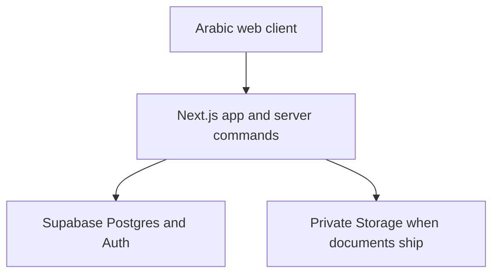

# Terranex Greenfield — 06 System Architecture & Security

**Status:** Execution architecture v2
**Decision:** One modular monolith, one database, one completed vertical slice at a time. ADR-0002 governs implementation sequencing.

## 1. Runtime shape

Terranex uses one maintained Next.js App Router application deployed as one unit, backed by one Supabase project: PostgreSQL, Auth, and private Storage. The logical product hierarchy is Organization → Investment Portfolio → Investment Project → sector objects; this hierarchy does not require microservices or a new ledger per level. The browser renders the experience; server code and database transactions remain authoritative for tenant access, approvals, balances, and financial effects.



No microservices, monorepo packages, queue, outbox, offline engine, or integration layer is created until an implemented workflow has that dependency.

## 2. Repository shape

```text
src/
├── app/                 routes, layouts, server entry points
├── features/            feature-owned UI, commands, queries, schemas
│   ├── auth/
│   ├── organizations/
│   └── projects/
└── shared/              proven cross-feature code only
    ├── ui/
    ├── validation/
    └── money/
supabase/
├── migrations/
└── tests/
```

The root is a normal single-package Next.js project. A folder is created only with its first real implementation. Feature code may use `shared`; features do not reach into another feature’s internals. Cross-feature behavior is exposed by a small public module.

## 3. Delivery rule

Each batch completes one user-visible workflow across the necessary layers:

1. route and Arabic/RTL UI;
2. typed input validation;
3. authenticated server command/query;
4. migration, constraints, RLS, and atomic transaction where required;
5. audit evidence for material changes;
6. loading, empty, error, forbidden, and responsive states;
7. targeted tests and build verification.

The conceptual domain catalog does not authorize placeholder entities, empty layers, generic CRUD, or prebuilt modules. R0 portfolio realignment is documentation/governance only: it does not authorize portfolio schema, routes, services, migrations, or UI by itself.

## 4. Command and data flow

- Queries are scoped to the authenticated user’s active organization on the server and by RLS.
- User commands accept business inputs and expected state, never authoritative balances, permissions, or organization ownership from the browser.
- Normal single-record writes may use a server action with the authenticated Supabase client.
- Multi-record or financially material writes use one transactional PostgreSQL function/RPC with validation, authorization, idempotency, and audit in the same transaction.
- Database constraints and RLS are authoritative even when application validation also exists.
- Posted financial facts will be immutable and corrected by reversal when those slices are implemented; GF-002 contains no ledger.

## 5. Tenancy and authorization

- Every tenant-owned table has `organization_id NOT NULL`.
- Cross-tenant relationships use organization-aware foreign keys or equivalent database constraints.
- RLS is enabled and default-deny on every exposed tenant table.
- Membership establishes organization access; project scope and maker-checker rules are added only in the slice that uses them.
- Server code never trusts a client-supplied organization ID without resolving and authorizing membership.
- Service-role credentials never enter browser code and are not used as a routine bypass for user commands.

GF-002 proves isolation with at least two organizations and attempts to read and mutate across the boundary.

## 6. Security baseline

- Supabase Auth session handling follows the maintained server/client pattern.
- Environment variables are schema-validated; secrets never enter Git, logs, test fixtures, or browser bundles.
- Validation runs at the boundary; database constraints protect invariant data.
- Sensitive files use private buckets and signed access only when the documents slice is implemented.
- Audit payloads contain identifiers and safe metadata, not secrets or unnecessary personal data.
- CSV/export cells are neutralized when exports are implemented.
- Dependencies are kept minimal, maintained, and used by the active slice.

Commercial release targets OWASP ASVS Level 2 proportionately, but unused security subsystems are not scaffolded.

## 7. Money boundary

When financial slices begin or are extended:

- money uses integer minor units plus ISO-4217 currency;
- no floating-point monetary arithmetic;
- balanced postings, idempotency, closed-period behavior, and reversal are database-enforced;
- cash, revenue, expense, valuation, allocation, distribution, and payment remain separate facts;
- statutory accounting and Egyptian tax/e-invoicing stay external/configured until professionally validated;
- portfolio roll-ups are projections over project truth, never a second mutable ledger;
- portfolio capital deployment never becomes investor contribution/ownership/allocation/distribution without an explicit approved business rule.

GF-002 may provide a shared money value/formatter only if the project form actually needs it; it must not build a ledger.

## 8. Deferred capabilities

| Capability | Introduce only when |
|---|---|
| Private Storage | a real document workflow is built |
| Transactional outbox/queue | an external consumer must receive durable asynchronous events |
| Inbox/webhooks | a signed external inbound integration exists |
| PWA/offline drafts | field capture is implemented and weak connectivity is validated |
| Background jobs | a bounded task cannot finish reliably in a request |
| Read projections/materialized views | measured query/reporting needs exceed direct queries |
| Internal package extraction | at least two real consumers and a stable boundary exist |
| Second sector module | Common Core and Real Estate deliver a working end-to-end slice |

## 9. Domain-assumption safety boundary

Architecture must fail closed on unresolved business semantics:

- do not add schema columns/tables, enums, RPC branches, permissions, routes, or configuration options merely to “prepare for” an unknown investor/legal rule;
- do not encode Portfolio as `fund`, `spv`, `legal_entity`, or `investor_pool` unless an approved decision establishes that meaning;
- do not derive ownership or entitlement from contribution/payment history;
- do not implement cross-project transfers, netting, recycling, or pooled cash from a dashboard/report requirement;
- record the missing decision in `docs/OPEN_BUSINESS_DECISIONS.md` and stop that dependent implementation while continuing unrelated bounded work.

The correct technical representation of an unknown business rule is **no implementation yet**, not a nullable column or generic rules engine.

## 10. Verification

For every completed slice, run the smallest truthful set:

- formatting/lint and typecheck;
- targeted unit and integration tests;
- migration replay and relevant database/RLS tests;
- production build;
- Arabic/RTL, mobile, loading, empty, error, and forbidden-state check;
- diff and secret scan.

Financial slices later add concurrency, idempotency, balance, reversal, and period-lock proofs. Do not claim unrun gates.

## 11. Initial decisions

| ID | Decision |
|---|---|
| A-001 | One root Next.js modular monolith |
| A-002 | One Supabase/PostgreSQL transactional system of record |
| A-003 | Server-authoritative commands; database-enforced tenant and financial invariants |
| A-004 | Arabic/RTL responsive web first; PWA/offline deferred |
| A-005 | Default-deny RLS and organization-aware integrity |
| A-006 | Direct in-process behavior first; outbox/queues only with a real integration |
| A-007 | Feature folders; shared extraction after two consumers |
| A-008 | External statutory GL and Egypt adapters remain outside the v1 core |
| A-009 | Portfolio is a logical management/reporting parent of projects; its introduction does not create a fund/legal entity, pooled economics, or second ledger |

## Sources

- [Next.js App Router documentation](https://nextjs.org/docs/app)
- [PostgreSQL Row Security Policies](https://www.postgresql.org/docs/current/ddl-rowsecurity.html)
- [Supabase Row Level Security](https://supabase.com/docs/guides/database/postgres/row-level-security)
- [Supabase Auth](https://supabase.com/docs/guides/auth)
- [Supabase Storage Access Control](https://supabase.com/docs/guides/storage/security/access-control)
- [OWASP ASVS](https://owasp.org/www-project-application-security-verification-standard/)
